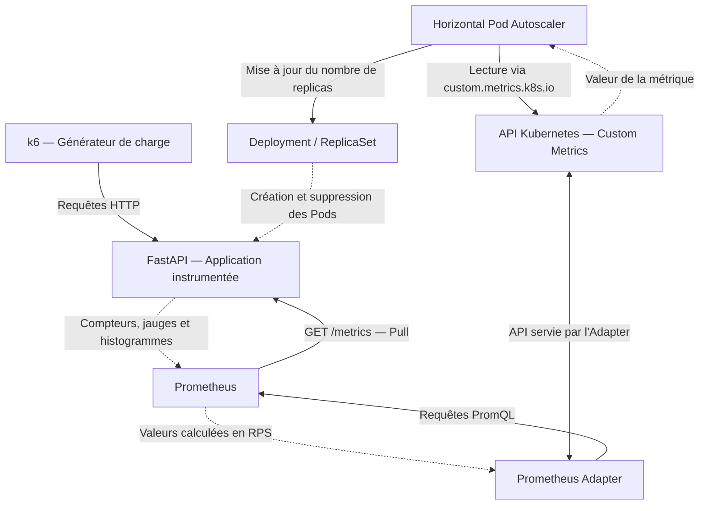

# HPA Metrics POC

**Démonstrateur d'autoscaling Kubernetes piloté par des métriques applicatives et externes, sans KEDA.**

## Objectif

Démontrer la capacité du *Horizontal Pod Autoscaler* (HPA) à ajuster dynamiquement le nombre de replicas d'une application Kubernetes à partir de **Custom Metrics** et d'**External Metrics**, en complément des métriques traditionnelles CPU et mémoire.

Le POC permet d'expérimenter différents signaux d'autoscaling, de simuler des montées en charge et d'observer les décisions prises par Kubernetes.

## Architecture

**Stack actuelle :** Kubernetes (kind), FastAPI, Prometheus, Prometheus Adapter, Metrics Server, HPA (`autoscaling/v2`) et k6.

> Le diagramme représente la chaîne **Custom Metrics** actuellement opérationnelle. Les variantes External Metrics et OpenTelemetry font partie des évolutions à expérimenter.

## Documentation

| Document | Contenu |
|---|---|
| [Installation](docs/01-installation.md) | Construction et validation reproductibles de l'environnement |
| [Démonstration](docs/02-demonstration.md) | Scénarios de charge, configuration HPA et observations |
| [Architecture](docs/03-architecture.md) | Mécanismes techniques, choix d'architecture et limites |

Les protocoles, mesures et conclusions des prochaines campagnes seront regroupés dans `docs/experiences/` (répertoire à créer).

## État d'avancement

| Jalon | État | Issues associées |
|---|---|---|
| Application FastAPI instrumentée | ✅ Validé | Socle initial |
| Collecte des métriques par Prometheus | ✅ Validé | Socle initial |
| Exposition des Custom Metrics à Kubernetes | ✅ Validé | Socle initial |
| Autoscaling HPA piloté par les RPS | ✅ Validé | Socle initial |
| Calibrage de la capacité applicative | ⬜ À réaliser | [#1](https://github.com/BazinFlorent/scaling-patterns-k8s/issues/1), [#3](https://github.com/BazinFlorent/scaling-patterns-k8s/issues/3) |
| Comparaison avec le HPA CPU | ⬜ À réaliser | [#1](https://github.com/BazinFlorent/scaling-patterns-k8s/issues/1), [#2](https://github.com/BazinFlorent/scaling-patterns-k8s/issues/2) |
| Scénarios de charge reproductibles (k6 / Locust) | 🟡 En cours | [#3](https://github.com/BazinFlorent/scaling-patterns-k8s/issues/3) |
| Autoscaling sur External Metrics | ⬜ À réaliser | [#7](https://github.com/BazinFlorent/scaling-patterns-k8s/issues/7) |
| Instrumentation et collecte alternatives (OpenTelemetry / eBPF) | ⬜ À réaliser | [#4](https://github.com/BazinFlorent/scaling-patterns-k8s/issues/4), [#5](https://github.com/BazinFlorent/scaling-patterns-k8s/issues/5), [#6](https://github.com/BazinFlorent/scaling-patterns-k8s/issues/6), [#9](https://github.com/BazinFlorent/scaling-patterns-k8s/issues/9) |
| Documentation et traçabilité expérimentale | 🟡 En cours | [#8](https://github.com/BazinFlorent/scaling-patterns-k8s/issues/8) |

**Périmètre :** démonstrateur technique local, destiné à l'expérimentation et à la validation de concepts d'architecture.
